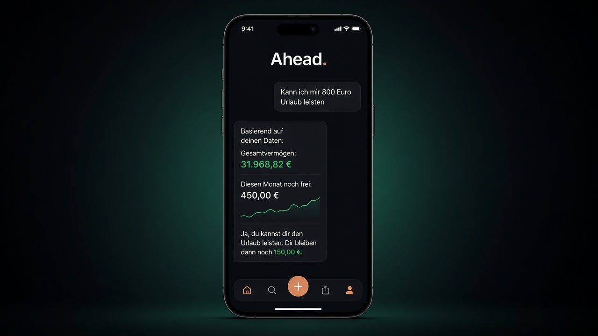

# Ahead

**Coach for first own finances in Germany.**

Ahead is a Flutter finance app for people in their first money years (~18–27). The product is **Buddy** — a coach in chat that answers with *your* numbers: salary, rent, Abos, next step. Banking and portfolio are optional context, not the centre.

> ChatGPT does not know your numbers. Buddy does.

Formerly *BudgetBuddy* — same codebase, new brand and niche.

<p align="center">
  
</p>

## Screenshots

<p align="center">
  
  
  
  
  
  
</p>

## Positioning

Ahead is for **first own finances in Germany** (~18–27): first salary, first flat, first Abos — not another multibanking or depot app.

Most money apps show **what you have**. Buddy answers **what to do next** with *your* numbers (never regulated investment advice). Banking and portfolio stay optional context.

**Not** ChatGPT without a ledger. **Not** a worse Finanzguru/Finanzfluss — a different job (life-start decisions).

North star: [docs/product_focus.md](docs/product_focus.md)  
Investor brief (DE): [docs/business_case.md](docs/business_case.md) — includes an honest differentiation audit.  
Pitch: [docs/pitch_deck.md](docs/pitch_deck.md) · [docs/pitch_deck.html](docs/pitch_deck.html) · [docs/Luis_Frenkler_PitchDeck.pdf](docs/Luis_Frenkler_PitchDeck.pdf).  
Store listing (DE): [docs/store_listing_de.md](docs/store_listing_de.md).

## Product

**Buddy (life-start coach)**
- Chat-first; answers grounded in spending, budgets, contracts, goals
- Default questions: Gehalt, Urlaub, Miete — not depot/wealth vanity
- Tool-using agent on device (search transactions, run month scenarios, savings plans)
- Receipt scan and natural-language quick entry
- Consent-gated cloud AI; on-device fallback; no IBANs in summaries

**Cash flow & foresight**
- Remaining budget and what-if (skip Abos, one-offs — nothing persisted)
- Subscriptions detected from recurring payments, including price-rise signals
- Notgroschen and a rough BAV / retirement question as orientation (not advice)

**Accounts & portfolio (supporting — never the hero)**
- PSD2 bank link (Enable Banking, read-only) and demo bank
- Auto-categorization and learned merchant rules
- Holdings / imports as optional Buddy context

**Security & sync**
- Local-first Hive storage; optional encrypted cloud vault (AES-256-GCM, password-derived key)
- Auth, biometric lock, hide balances
- Freemium: limited free Buddy questions; Ahead Plus (€4.99 / month or €39.99 / year, 7-day trial)

## Tech stack

| Layer | Choice |
|---|---|
| App | Flutter / Dart |
| Local storage | Hive |
| Security | `local_auth`, `flutter_secure_storage`, bcrypt / session hashes |
| Backend | Dart HTTP server (bank, portfolio, vault, AI proxy) |
| Integrations | Enable Banking (PSD2), Finnhub, optional Parqet, server-side LLM |
| Tests | `flutter_test` (unit & widget) |

## Repository layout

```
lib/          # UI, services, models
backend/      # API: bank, portfolio, vault, Buddy
test/         # Automated tests
landing/      # Marketing site
docs/         # Screenshots and launch notes
brand/        # Brand assets
```

## Getting started

Requires the [Flutter SDK](https://docs.flutter.dev/get-started/install).

```bash
flutter pub get
flutter run
```

```bash
flutter test
```

Web:

```bash
tool/build_web.sh
python3 tool/serve_web.py   # http://127.0.0.1:8765
```

Backend: see [backend/README.md](backend/README.md).

> UI language: German.

Inter font: SIL Open Font License (`assets/fonts/Inter-OFL.txt`).

## Author

**Luis Frenkler** — built Ahead end to end: Flutter client, Dart backend, vault, bank sync, Buddy agent, portfolio, and soft-launch path.

[github.com/LuisFrenkler/budget-buddy](https://github.com/LuisFrenkler/budget-buddy)
