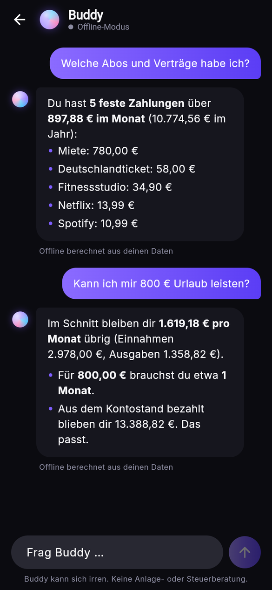
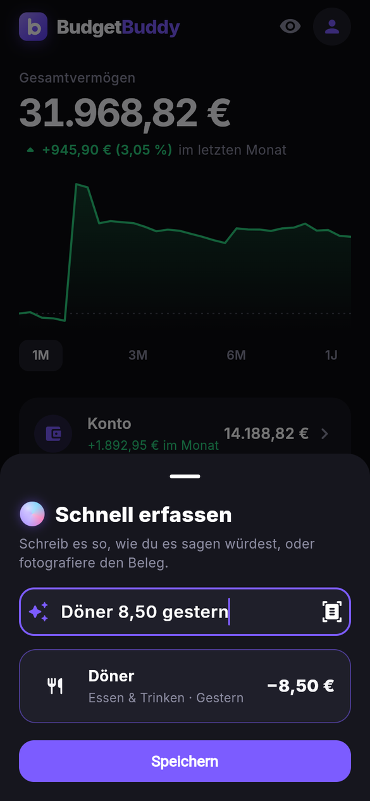
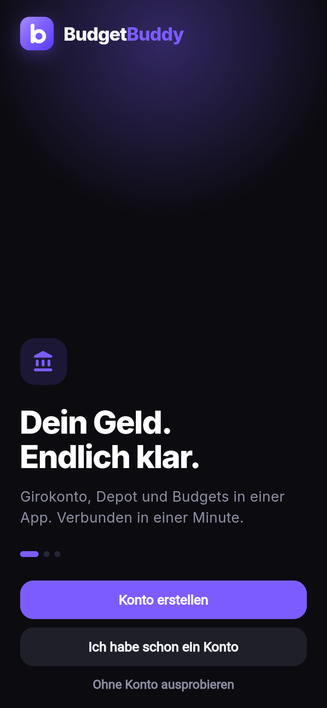
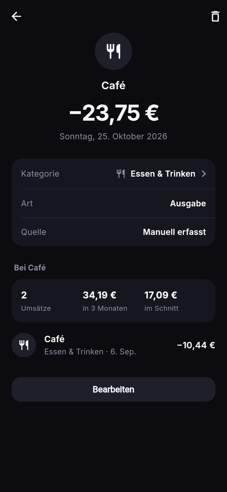
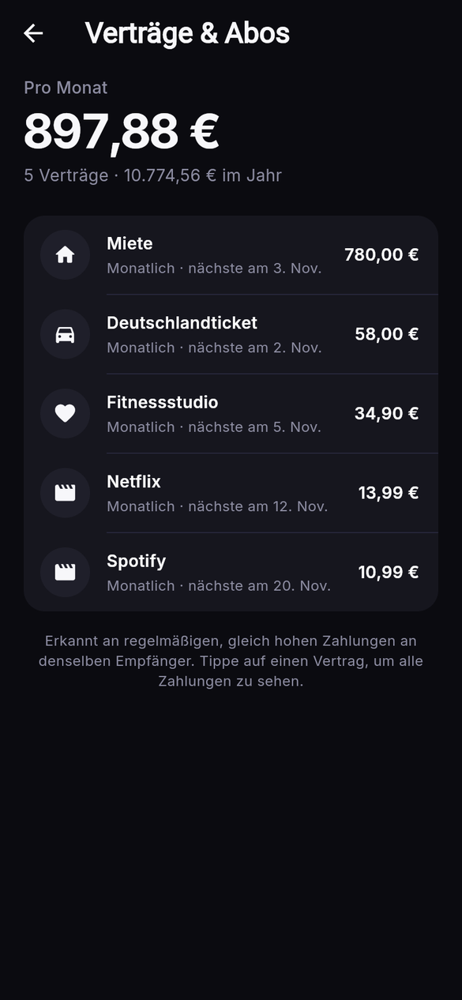

# BudgetBuddy

A personal finance app built with **Flutter** that brings your budget and your investment portfolio together in one place. Your budget data is stored locally on the device. An optional account links your real bank account for automatic bookings.

<p align="center">
  
</p>

## Screenshots

<p align="center">
  
  
  
  
  
  
  
  
</p>

## Features

**Buddy, the AI finance coach** (Claude Opus 5.5)
- Ask anything about your money – "Wo kann ich sparen?", "Kann ich mir 800 € Urlaub leisten?" – and get a short, concrete answer computed from your real numbers, streamed word by word
- **Receipt scan:** snap a receipt, and Claude reads merchant, total, date and category
- **Plain-language entry:** type "Döner 8,50 gestern" and watch it turn into a booking while you type (offline parser), refined by Claude on save
- Privacy first: Buddy sends only a summary (totals per month and category, budgets, contracts, merchant names, no IBAN) and only after a one-time consent. The API key stays on the server, with a daily limit per user
- Works without AI too: offline answers computed on the device, clearly labeled

**Real bank connection**
- Links your actual checking account through Enable Banking (PSD2, 2,500+ European banks, read-only). Login happens at your bank, never in the app
- The app notices the granted access by itself, imports balance and bookings and keeps them current: on start, by tapping the bank chip, or by pulling down
- New bookings are categorized automatically (REWE → Lebensmittel, DB → Transport, …), and the app learns from your corrections
- An opening balance makes the app's Kontostand match the bank exactly, although banks only hand out a few months of history
- A built-in demo bank lets anyone try the whole flow without credentials. See [backend/README.md](backend/README.md)

**Accounts & security**
- Sign up and sign in with email and password. On the server, passwords are bcrypt-hashed, session tokens are stored only as SHA-256, and repeated wrong passwords lock the email
- The session token lives in the Keychain / Keystore (flutter_secure_storage). Bank links belong to one account and nobody else can read them
- Deleting your account in the app removes it with all bank links, as the App Store requires
- "Try without an account" for a fully offline app
- App lock with Face ID / fingerprint / device PIN, plus a privacy mode that hides every balance with one tap

**Overview**
- Net worth (account + depot) with an interactive chart: drag across it to read any day's value
- Account and depot at a glance, budget rings, the most relevant insight and the latest transactions

**Account**
- Balance history with *Umsätze*, *Budgets* and *Analyse*
- Transaction details: category change in one tap, source (bank or manual), and what you spent with the same merchant in the last three months
- **Contracts & subscriptions** are detected automatically from regular, equal payments: monthly and yearly cost, next due date, and a warning when a price goes up
- Fast entry with number pad, recurring transactions, budgets with traffic-light colors, monthly analysis with a drill-down donut

**Depot**
- Portfolio value with an interactive chart, gain/loss, return and an allocation donut
- Live prices, a detail page per position, and import from a **Trade Republic** export

**Data**
- CSV import/export, full JSON backup / restore, dark and light mode, haptics, achievements
- Demo mode with six months of realistic sample data

## Tech Stack

| Area | Technology |
|---|---|
| App | Flutter, Dart |
| Storage | Hive (local NoSQL database) |
| Security | local_auth (biometrics / device credentials) |
| Data | CSV import/export, JSON backup |
| APIs | Claude API (Opus 5.5), Finnhub (prices), Enable Banking (PSD2), Parqet |
| Backend | Dart HTTP server (`backend/server.dart`) |
| Testing | flutter_test – 86 unit and widget tests |

## Project Structure

```
lib/
├── models/     # Transaction, Budget, Holding, Recurring, Badge
├── screens/    # Shell, Overview, Account (budgets, analysis), Depot, Add, Profile, ...
├── services/   # Database, balance history, importers, backup, prices, insights, demo data
├── utils/      # Theme, money and date formatting, number pad input, instrument list
└── widgets/    # Interactive chart, big number, segmented control, transaction row
backend/        # Server for bank (PSD2) and depot sync, with a demo bank
test/           # Unit and widget tests
landing/        # Landing page for the app
```

## Getting Started

Requires the [Flutter SDK](https://docs.flutter.dev/get-started/install).

```bash
flutter pub get
flutter run
```

Live prices are optional. To enable them, pass a free [Finnhub](https://finnhub.io) API key:

```bash
flutter run --dart-define=FINNHUB_KEY=your_key
```

Run the tests:

```bash
flutter test
```

> The app's user interface is in German.

The Inter typeface is included under the SIL Open Font License (see `assets/fonts/Inter-OFL.txt`).
