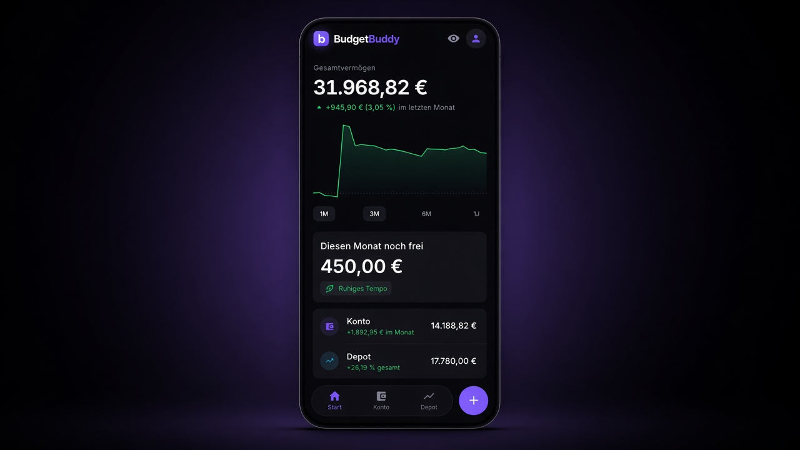
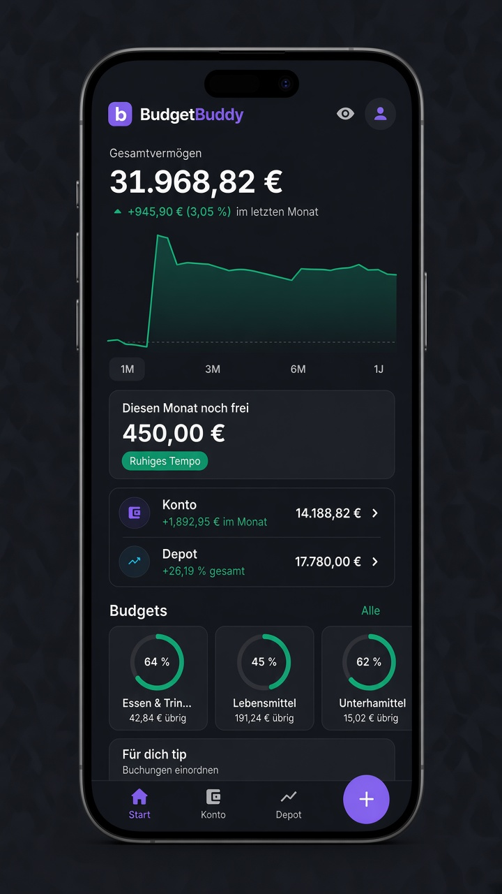
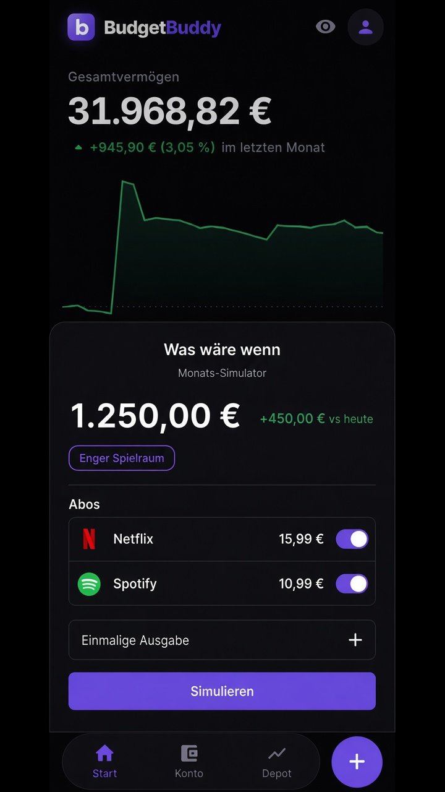
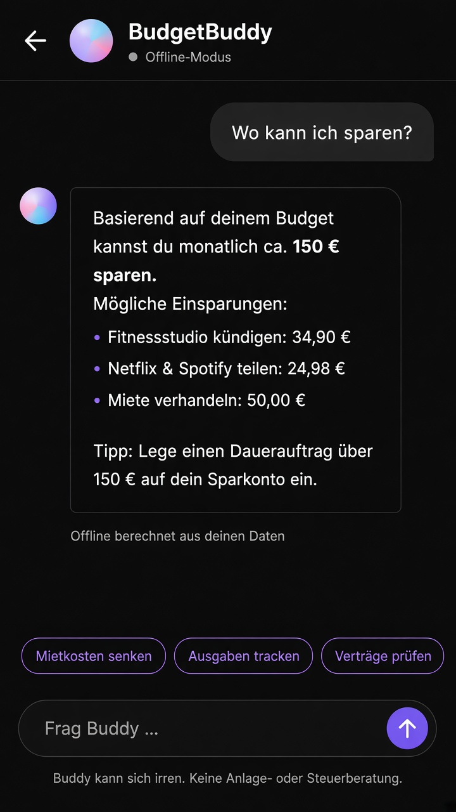
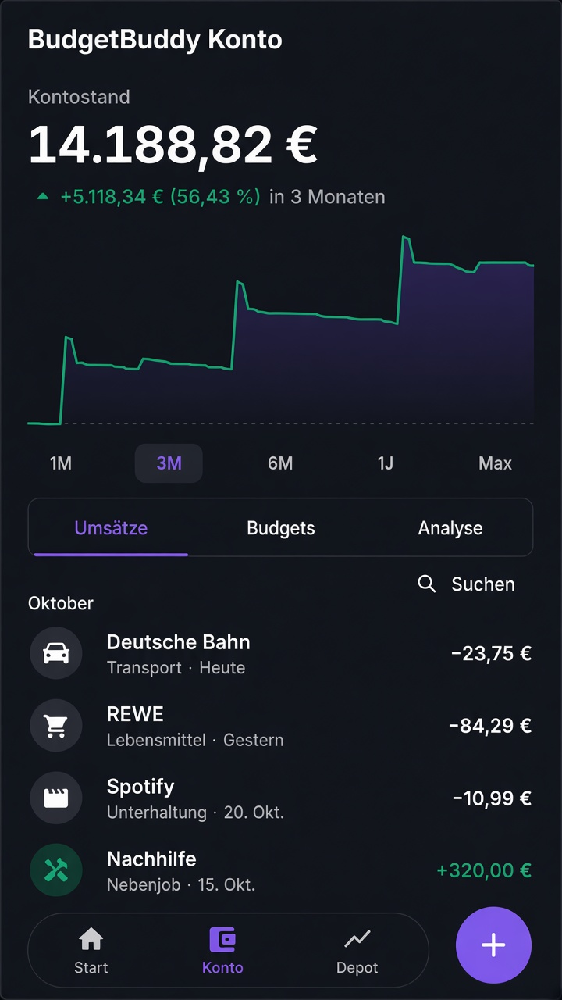
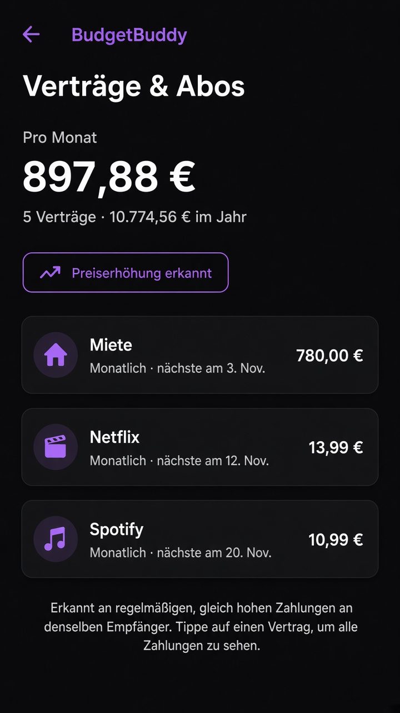
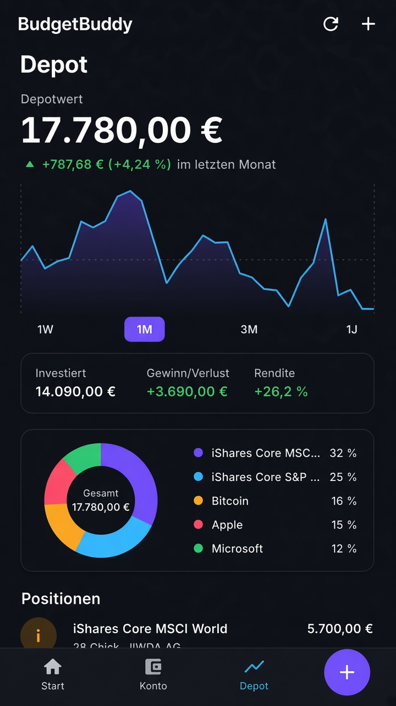

# BudgetBuddy

**Personal finance app built with Flutter** — accounts, budgets, subscriptions, brokerage portfolio, and cash-flow forecasting in one product.

Local-first data on device, optional encrypted cloud backup, and real bank connectivity (PSD2, read-only). Soft-launched end-to-end: client, Dart backend, vault, and integrations.

<p align="center">
  
</p>

## Screenshots

<p align="center">
  
  
  
  
  
  
</p>

## Features

**Monthly forecast & what-if simulator**
- Remaining budget for the month from income, fixed costs, savings goals, and spending pace
- Interactive scenarios (skip subscriptions, one-off purchases, adjust savings) with live delta — nothing is persisted

**Buddy (AI finance coach)**
- Answers grounded in the user’s real numbers (spending, goals, contracts)
- Receipt scan and natural-language quick entry
- On-device fallback when the model is unavailable
- Privacy-first: consent-gated; summary only (no IBAN); API keys stay on the server

**Banking & categorization**
- PSD2 bank link (Enable Banking, read-only) plus a demo bank for local trials
- Auto-categorization, learned merchant rules, SEPA noise scrubbed from titles
- Ledger calibrated to the bank opening balance

**Accounts, budgets, subscriptions**
- Transactions, budget traffic lights, monthly analysis
- Recurring payments detected as subscriptions, including price-rise signals

**Portfolio & net worth**
- Holdings with live quotes, allocation, Trade Republic import
- Combined net worth (cash + brokerage) with an interactive chart

**Security & sync**
- Auth, biometric lock, hide balances
- Client-side vault: AES-256-GCM; key derived from the password (server stores ciphertext only)

## Tech stack

| Layer | Choice |
|---|---|
| App | Flutter / Dart |
| Local storage | Hive |
| Security | `local_auth`, `flutter_secure_storage`, bcrypt / session hashes on the server |
| Backend | Dart HTTP server (bank, portfolio, vault, AI proxy) |
| Integrations | Enable Banking (PSD2), Finnhub (quotes), optional Parqet, server-side LLM API |
| Tests | `flutter_test` (unit & widget) |

## Repository layout

```
lib/          # UI, services, models
backend/      # API: bank, portfolio, vault, Buddy
test/         # Automated tests
landing/      # Marketing landing page
docs/         # Screenshots and launch notes
```

## Getting started

Requires the [Flutter SDK](https://docs.flutter.dev/get-started/install).

```bash
flutter pub get
flutter run
```

```bash
flutter test
```

Web build:

```bash
tool/build_web.sh
python3 tool/serve_web.py   # http://127.0.0.1:8765
```

Backend setup: see [backend/README.md](backend/README.md).

> UI language: German.

Inter font is included under the SIL Open Font License (`assets/fonts/Inter-OFL.txt`).

## Author

**Luis Frenkler** — designed and built BudgetBuddy from architecture through soft launch (bank sync, encrypted vault, forecast, Buddy, portfolio).

[github.com/LuisFrenkler/budget-buddy](https://github.com/LuisFrenkler/budget-buddy)
