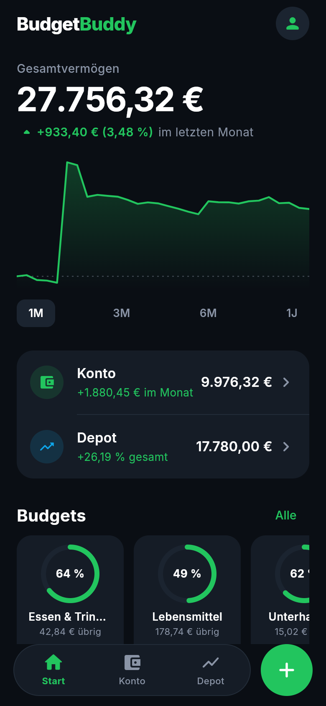
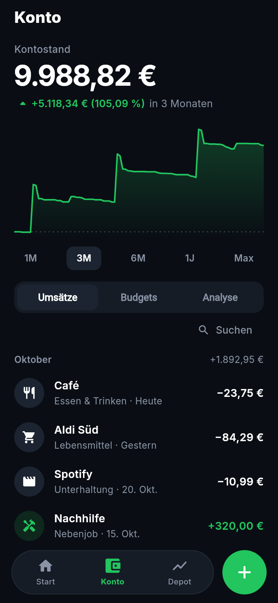
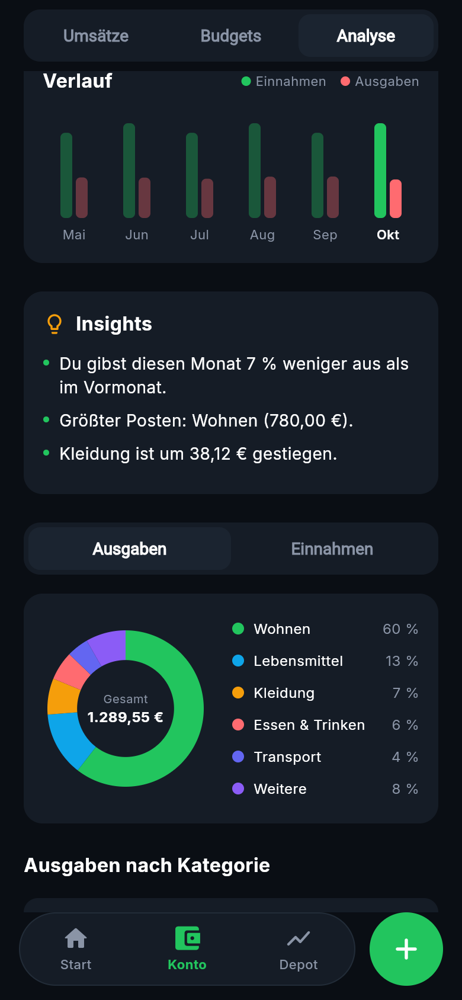
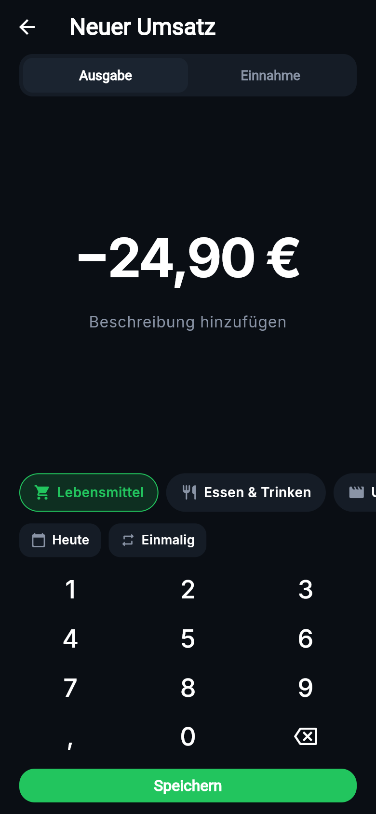

# BudgetBuddy

A personal finance app built with **Flutter** that brings your budget and your investment portfolio together in one place. All data is stored locally on the device. Nothing leaves the phone unless you explicitly connect a bank account.

<p align="center">
  
</p>

## Screenshots

<p align="center">
  
  
  
  
  
</p>

## Features

**Overview**
- Net worth (account + depot) with an interactive chart: drag across it to read any day's value, switch between 1M, 3M, 6M and 1J
- Account and depot at a glance, current budgets as progress rings, the most relevant insight and the latest transactions – everything leads deeper with one tap

**Account**
- Balance history with the same interactive chart, plus three sections: *Umsätze*, *Budgets* and *Analyse*
- Transactions grouped by month, with search, editing and swipe-to-delete with undo
- Fast entry: big amount display, on-screen number pad, category chips sorted by usage, date and repeat chips (a physical keyboard works too)
- Recurring transactions (e.g. rent, salary) that are generated automatically, including any that came due while the app was closed
- Budgets per category that turn yellow from 80 % and red when over the limit; tap one to see its transactions
- Monthly analysis: income vs. expenses for six months (tap a month to jump to it), a donut by category (tap a slice to highlight it, tap again to see its transactions) and automatic insights compared to last month

**Depot**
- Portfolio value with an interactive chart, overall gain/loss and return, and an interactive allocation donut
- Detail page per position with an interactive price chart
- Built-in search for well-known stocks, ETFs and crypto, with live prices via the Finnhub API; pull to refresh
- Import of positions from a **Trade Republic** transaction export: buys and sells are aggregated into net positions with an average buy price

**Data & Security**
- Import transactions or positions from CSV, CSV export and full JSON backup / restore
- App lock with Face ID / fingerprint / device PIN, re-locks when the app goes to the background
- Dark and light mode, Inter typeface, haptic feedback, achievements in the profile
- Demo mode with six months of realistic sample data to explore the app instantly

**Optional live sync**
A small Dart backend acts as a proxy to link a real bank account (GoCardless, PSD2) and a Parqet depot, so API secrets never live in the app. See [backend/README.md](backend/README.md).

## Tech Stack

| Area | Technology |
|---|---|
| App | Flutter, Dart |
| Storage | Hive (local NoSQL database) |
| Security | local_auth (biometrics / device credentials) |
| Data | CSV import/export, JSON backup |
| APIs | Finnhub (prices), GoCardless Bank Account Data, Parqet |
| Backend | Dart HTTP server (`backend/server.dart`) |
| Testing | flutter_test – 86 unit and widget tests |

## Project Structure

```
lib/
├── models/     # Transaction, Budget, Holding, Recurring, Badge
├── screens/    # Shell, Overview, Account (budgets, analysis), Depot, Add, Profile, ...
├── services/   # Database, balance history, importers, backup, prices, insights, demo data
├── utils/      # Theme, money and date formatting, number pad input, instrument list
└── widgets/    # Interactive chart, big number, segmented control, transaction row
backend/        # Optional proxy server for bank and depot sync
test/           # Unit and widget tests
landing/        # Landing page for the app
```

## Getting Started

Requires the [Flutter SDK](https://docs.flutter.dev/get-started/install).

```bash
flutter pub get
flutter run
```

Live prices are optional. To enable them, pass a free [Finnhub](https://finnhub.io) API key:

```bash
flutter run --dart-define=FINNHUB_KEY=your_key
```

Run the tests:

```bash
flutter test
```

> The app's user interface is in German.

The Inter typeface is included under the SIL Open Font License (see `assets/fonts/Inter-OFL.txt`).
