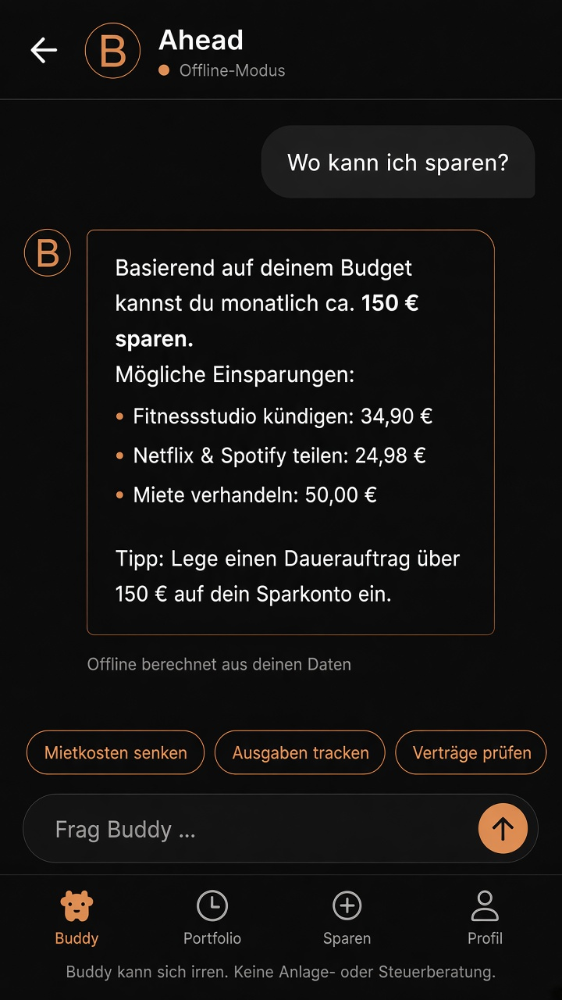
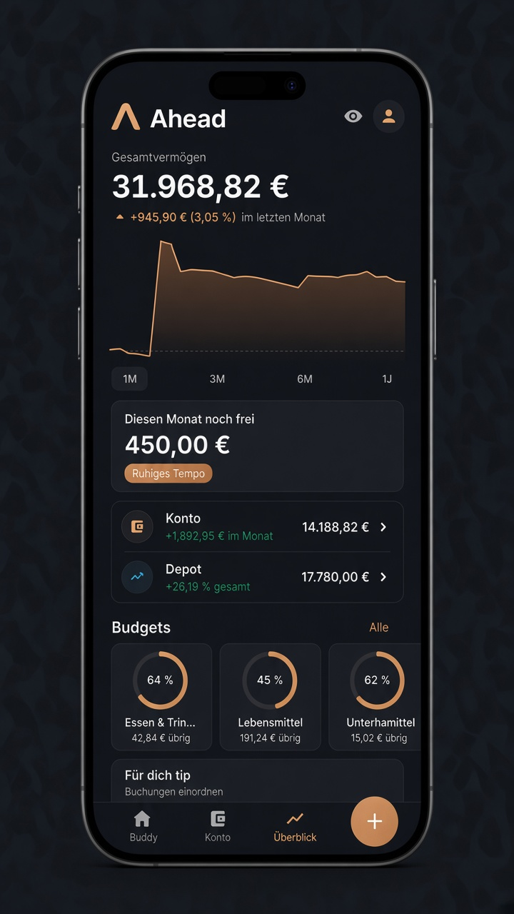
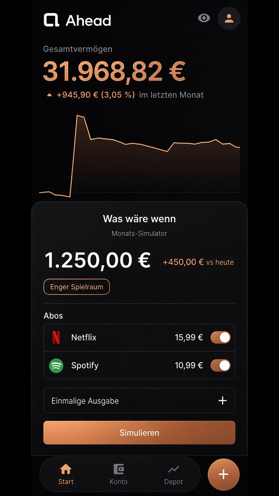
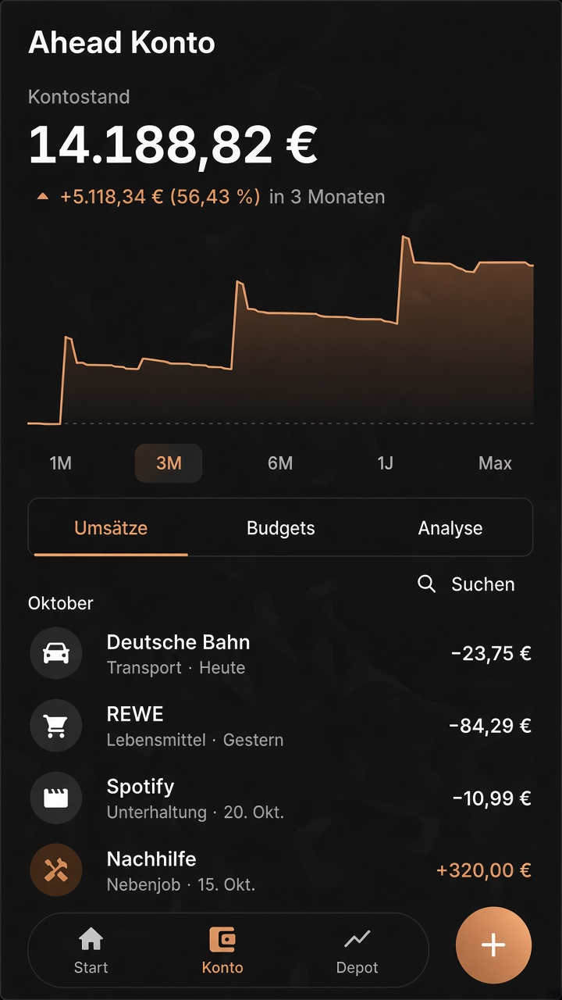
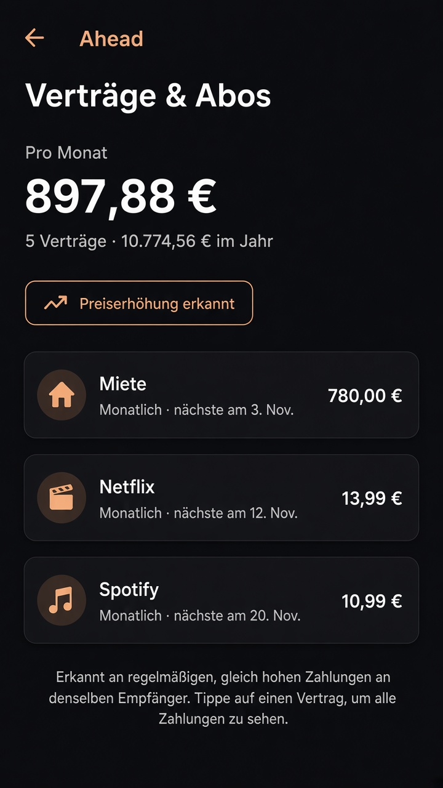
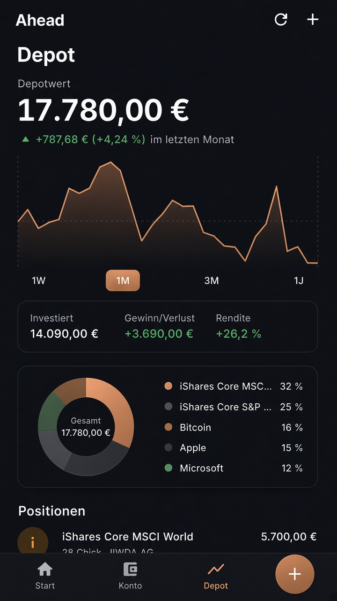

# Ahead

**Your buddy for money and the future.**

Ahead is a Flutter finance app for young adults in Germany. The product is **Buddy** — an AI money coach in chat that answers with *your* numbers. Banking, portfolio, and retirement context are data sources for Buddy, not the centre of the product.

> ChatGPT does not know your numbers. Buddy does.

Formerly *BudgetBuddy* — same codebase, new brand and positioning.

<p align="center">
  
</p>

## Screenshots

<p align="center">
  
  
  
  
  
  
</p>

## Positioning

Most German money apps show **what you have**. Ahead focuses on **what to do next** — before you book the trip, cancel the subscription, or move in together — with a coach that explains, calculates, and suggests next steps (never regulated investment advice).

**Wedge:** *Ask Buddy before you spend.* Banking and portfolio are data sources for Buddy, not the product centre.

Investor brief (DE): [docs/business_case.md](docs/business_case.md) — problem, market, competition, model, ask.  
Pitch deck (Guy Kawasaki 10 / WHU MiE, EN): [docs/pitch_deck.md](docs/pitch_deck.md) · [docs/pitch_deck.html](docs/pitch_deck.html) · [docs/Luis_Frenkler_PitchDeck.pdf](docs/Luis_Frenkler_PitchDeck.pdf).

## Product

**Buddy (AI coach)**
- Chat-first home screen; answers grounded in the user’s real spending, budgets, contracts, goals, and portfolio
- Tool-using agent on device (search transactions, run month scenarios, calculate savings plans)
- Receipt scan and natural-language quick entry
- Consent-gated cloud AI; on-device fallback when unavailable; no IBANs in summaries

**Cash flow & foresight**
- Remaining budget for the month and a what-if simulator (skip subscriptions, one-offs, adjust savings — nothing persisted)
- Subscriptions detected from recurring payments, including price-rise signals
- Savings goals and a rough retirement gap as orientation (not advice)

**Accounts & portfolio (supporting)**
- PSD2 bank link (Enable Banking, read-only) and demo bank
- Auto-categorization and learned merchant rules
- Holdings with quotes / imports — useful context for Buddy, not the hero feature

**Security & sync**
- Local-first Hive storage; optional encrypted cloud vault (AES-256-GCM, password-derived key)
- Auth, biometric lock, hide balances
- Freemium: limited free Buddy questions; Ahead Plus (€4.99 / month or €39.99 / year, 7-day trial)

## Tech stack

| Layer | Choice |
|---|---|
| App | Flutter / Dart |
| Local storage | Hive |
| Security | `local_auth`, `flutter_secure_storage`, bcrypt / session hashes |
| Backend | Dart HTTP server (bank, portfolio, vault, AI proxy) |
| Integrations | Enable Banking (PSD2), Finnhub, optional Parqet, server-side LLM |
| Tests | `flutter_test` (unit & widget) |

## Repository layout

```
lib/          # UI, services, models
backend/      # API: bank, portfolio, vault, Buddy
test/         # Automated tests
landing/      # Marketing site
docs/         # Screenshots and launch notes
brand/        # Brand assets
```

## Getting started

Requires the [Flutter SDK](https://docs.flutter.dev/get-started/install).

```bash
flutter pub get
flutter run
```

```bash
flutter test
```

Web:

```bash
tool/build_web.sh
python3 tool/serve_web.py   # http://127.0.0.1:8765
```

Backend: see [backend/README.md](backend/README.md).

> UI language: German.

Inter font: SIL Open Font License (`assets/fonts/Inter-OFL.txt`).

## Author

**Luis Frenkler** — built Ahead end to end: Flutter client, Dart backend, vault, bank sync, Buddy agent, portfolio, and soft-launch path.

[github.com/LuisFrenkler/budget-buddy](https://github.com/LuisFrenkler/budget-buddy)
